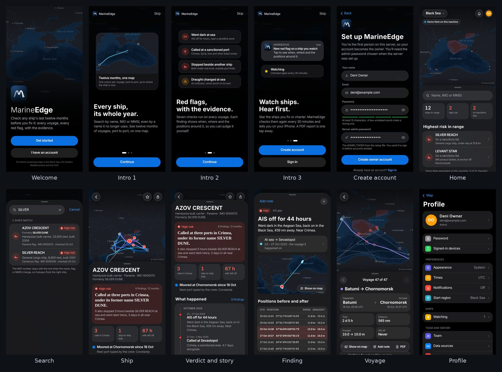
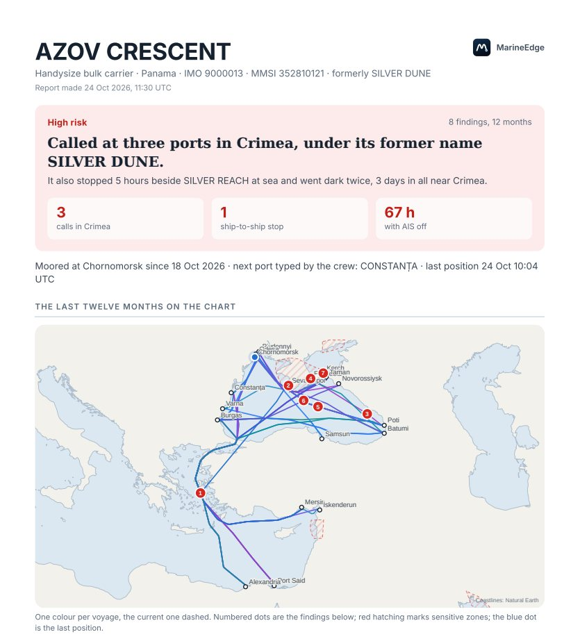

# MarineEdge

**Check any ship's last twelve months before you fix it: every voyage, every red flag, with the evidence.**

MarineEdge is a ship due-diligence app for trading desks that charter ships or accept cargoes of grain, oilseeds, vegetable oils and dry bulk in the Black Sea, the Strait of Hormuz, the Gulf of Oman and the UAE. Search a ship by name, former name, IMO or MMSI number: MarineEdge draws its voyages for the past year, runs seven red-flag rules drawn from sanctions guidance, shows the positions behind every finding, and sums it up in one sentence and a PDF you can file. It runs on your own server, installs on an iPhone like an app, and records the free AIS feed, so its history costs nothing.



*The app at iPhone size. The ships are the generated demo fleet of a development machine; a real server shows only real ships.*

## What it does

- **Search** by name, former name, IMO or MMSI. Ships are keyed on the IMO number, so a renamed or reflagged ship is still the same ship.
- **Twelve months on one map:** voyages port to port, one colour each, the current one dashed to the ship's latest position.
- **Seven red-flag rules, each with its evidence:** sanctions-list hits (OFAC, EU, UK), calls at sensitive ports (occupied Crimea and Azov coast, Iran, North Korea; Syria available, off by default), AIS gaps, draught changes at sea, possible ship-to-ship transfers, position jumps (labelled GPS jamming where jamming is known), and name, flag or MMSI changes.
- **A verdict in one sentence,** written by fixed rules, never generated: *"Called at three ports in Crimea, under its former name SILVER DUNE. It also stopped 5 hours beside SILVER REACH at sea and went dark twice, 3 days in all near Crimea."*
- **The region now:** every ship heard in the last six hours, how many are high risk or on sanctions lists, and the riskiest ones with the reason in plain words.
- **Watch and hear first:** watched ships are re-checked every 30 minutes; new findings arrive as notifications that open the finding itself.
- **A team tool:** accounts by invitation, admin and analyst roles, notes on a ship, a voyage or a single finding.
- **A PDF report** in one tap, saying word for word what the app says.
- **Run from a phone:** data sources, team, email, thresholds, zones, maps and the server are all managed in the app. No terminal, ever.



## Why MarineEdge

The established screening platforms (Windward, Lloyd's List Intelligence, S&P Global, Kpler's MarineTraffic, Pole Star) cover every ship worldwide with satellite data, imagery and ownership records, and are priced per user: Windward lists $29,000 per user per year, and S&P Global's maritime risk suite £28,000 to £96,000 per user. Public trackers cost little but do no screening. MarineEdge sits between them:

- **You can see why.** Seven published rules, every threshold editable, every finding with the positions behind it, the same answer every time. Platform risk scores come from models whose workings are not published.
- **Cost does not grow with the team:** a server, plus history only for the ships you choose to buy. No per-user fees.
- **Your screening stays on your server:** which ships you are about to fix, your notes and your reports.
- **Built for these lanes:** occupied Crimea and the Azov coast, the Turkish Straits, Hormuz and the Gulf, on an iPhone.
- **Honest about its limits:** it hears coastal receivers only, screens the ship rather than its owners, and has no satellite imagery. For the ship you are about to fix, a platform check can be added on top.

The full comparison, with sources: [docs/PRODUCT.md](docs/PRODUCT.md#how-marineedge-compares).

## How it decides

| Rule | Fires when (default thresholds, all editable in the app) | Severity |
|---|---|---|
| Sanctions hit | The IMO number is on the OFAC SDN list, the EU financial-sanctions list or the UK Sanctions List, as downloaded today (the EU's separate list of ships banned from its ports is next) | High |
| Call at a sensitive port | A port call or anchorage inside an enabled zone: Crimea, the occupied Azov coast, Iranian waters, North Korean waters (Syria ships switched off) | High |
| AIS gap | No position for more than 6 h at sea; High beyond 24 h or within 100 nm of a zone; Info, not counted, where no receiver can hear | Medium / High |
| Draught change at sea | Reported draught moves 1.0 m or more with no port call between, after a stop at sea or a dark period (an indicator, not proof: the crew types it). Typed in while under way, it is Info | High / Info |
| Possible ship-to-ship transfer | Under 1 knot outside port for 2 h or more with another ship (with an IMO number) within 500 m, or alongside within 150 m when at anchor | High |
| Position jump | Two fixes imply more than 30 knots; "possible GPS jamming" inside known jamming areas | Medium |
| Identity change | Name, flag or MMSI changed in 12 months | Info, Medium if more than one |

The verdict is **High risk** with any High finding, **Review** with Medium ones, **No red flags** when nothing is found in enough history, and **Not enough history** when there are fewer than 14 days or 50 positions to judge from. [docs/METHODOLOGY.md](docs/METHODOLOGY.md) explains each rule, its limits, and the official guidance behind it.

## How it works

```
search ─► identify (IMO) ─► positions, 12 months ─► clean ─► port calls ─► seven rules ─► voyages ─► verdict ─► map, story, PDF
             │                    │
             │                    ├─ recorded on your server from the free aisstream.io feed (no cost, coastal receivers)
             │                    └─ a ship's full year bought once from Datalastic when it matters (kept for good)
             └─ sanctions lists (OFAC SDN, EU, UK) downloaded daily; zones and ports from config/
```

The engine is pure Python with no web or database code: the same input always gives the same findings and the same words, and every rule is tested on synthetic tracks. A Global Fishing Watch cross-check sits beside the findings as a second opinion.

## Technology

| | |
|---|---|
| App | Plain HTML, CSS and JavaScript, no framework and no build step; installable PWA with offline shell and Web Push |
| Map | MapLibre GL JS, vendored; Natural Earth inside the app, OpenStreetMap detail (Protomaps) served by your own server; no map service or key |
| API | Python, FastAPI, one framework-free router shared with a standard-library dev server |
| Data | PostgreSQL 16 with PostGIS |
| Reports | Jinja2 HTML printed to PDF by Playwright's Chromium |
| Server | Docker Compose (db, api, recorder, web, Caddy with automatic HTTPS); updates itself from GitHub behind its own test suite |

More in [docs/ARCHITECTURE.md](docs/ARCHITECTURE.md).

## Try it on a laptop

```bash
make dev        # = cd backend && API_TOKENS=admin:dev-setup-code:admin python3 -m app.devserver
```

Open `http://localhost:8080`, tap **Get started › Create account** and use `dev-setup-code` as the server admin password. The development server shows a generated demo fleet (`AZOV CRESCENT`, `LEVANT STAR`, `SILVER REACH`, `DOBRUJA STAR` are the interesting ones); a real server never does. It needs only Python 3.11+ and PyYAML; the PDF needs Playwright's Chromium.

Full stack with PostGIS: `cp .env.example .env`, set `API_TOKENS` (and `VVT_PROVIDER=mock` with `VVT_ALLOW_MOCK=1` for the demo fleet), then `docker compose up --build` and open `http://localhost:8080`.

## Put it on a server

One paste: `deploy/cloud-init.yaml` into an Ubuntu server's user-data field (AWS, Google Cloud, Oracle, Hetzner and others). It installs Docker, PostGIS, the API, the recorder, the web app and Caddy with HTTPS, then updates itself from GitHub every 10 minutes, installing a new version only after the whole test suite passes on the server. Everything after that is done in the app. Step by step: [docs/DEPLOY.md](docs/DEPLOY.md) and, for free hosting, [docs/FREE-STACK.md](docs/FREE-STACK.md).

## Tests and checks

```bash
make test       # 73 tests: pytest -q, or python3 -m tests.run without pytest
make lint       # ruff (classic rules, pinned in backend/pyproject.toml)
```

The tests cover the seven rules and the voyage logic on synthetic tracks, the sanctions-list parsers (OFAC, EU, UK, OpenSanctions), the fetch-once cache, accounts (setup, invites, rate limits, resets, sessions), the HTTP router (auth levels, CSRF, permissions, no demo fleet on a server), the verdict wording, the report and notifications, the recorded feed, and PostgresStore (fully against PostGIS when `DATABASE_URL` is set).

## API

Everything the app shows comes from a JSON API under `/api`, usable from scripts with a token from the server's `.env`:

```bash
curl -s -H "Authorization: Bearer $MARINEEDGE_TOKEN" "https://<your server>/api/vessels/search?q=silver"
curl -s -H "Authorization: Bearer $MARINEEDGE_TOKEN" "https://<your server>/api/vessels/9000013/analysis?track=0"
```

Every route, its auth level and its JSON: [docs/API.md](docs/API.md).

## Documentation

| For | Read |
|---|---|
| What it does, who it is for, how it compares | [docs/PRODUCT.md](docs/PRODUCT.md) |
| How each red flag and the verdict are decided | [docs/METHODOLOGY.md](docs/METHODOLOGY.md) |
| Where things stand, what is next | [docs/STATUS.md](docs/STATUS.md) |
| What only the owner can do, from an iPhone | [docs/OWNER-CHECKLIST.md](docs/OWNER-CHECKLIST.md) |
| Data sources, costs and terms | [docs/PROVIDERS.md](docs/PROVIDERS.md) · [docs/FREE-STACK.md](docs/FREE-STACK.md) |
| Installing and running a server | [docs/DEPLOY.md](docs/DEPLOY.md) |
| How it is built | [docs/ARCHITECTURE.md](docs/ARCHITECTURE.md) · [docs/API.md](docs/API.md) |
| The original specification | [docs/BRIEF.md](docs/BRIEF.md) |
| AI coding agents | [AGENTS.md](AGENTS.md) (Claude Code reads it through [CLAUDE.md](CLAUDE.md)) · [llms.txt](llms.txt) for AI tools reading the repository |

## Status

Version 1.0 is live on the first server (an AWS trial) since 24 October 2026. The voyage map and red flags are built and tested on synthetic tracks; acceptance on real ships waits for the first paid history pull. [docs/STATUS.md](docs/STATUS.md) is kept current.

## Credits

Map data: Natural Earth (public domain) and © OpenStreetMap contributors (ODbL) via Protomaps. Map engine: MapLibre GL JS (BSD-3-Clause). Map fonts: Noto Sans (SIL Open Font License). Live AIS: aisstream.io. Cross-check: Global Fishing Watch (CC BY-NC 4.0). Sanctions data: the US Treasury (OFAC), the European Union and the UK Foreign, Commonwealth & Development Office.
